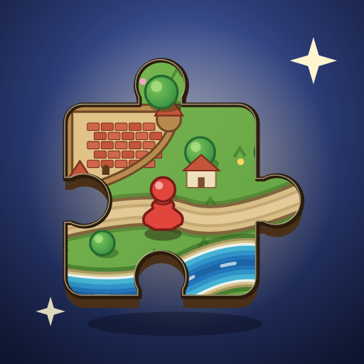
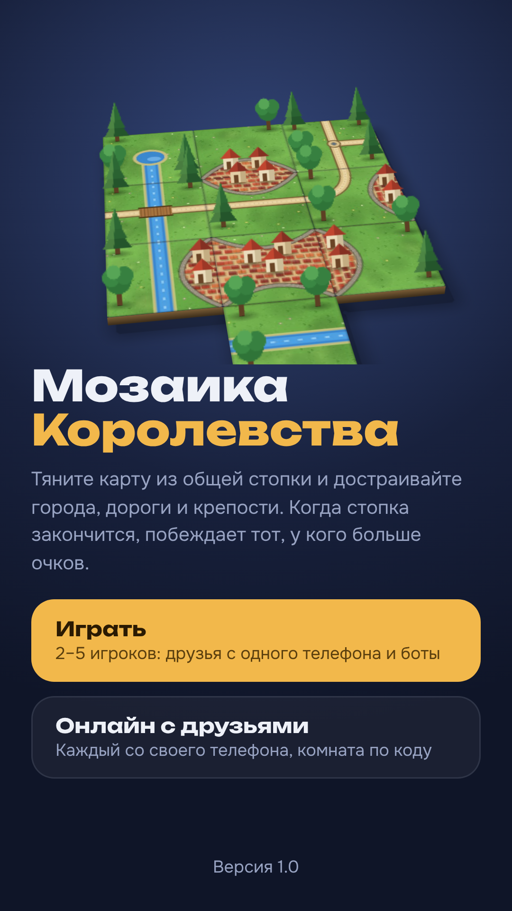
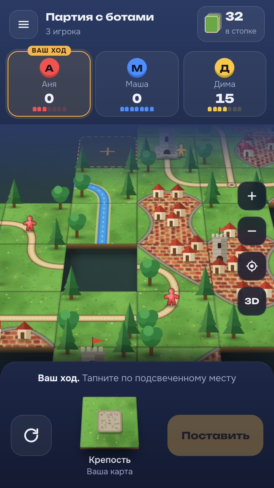
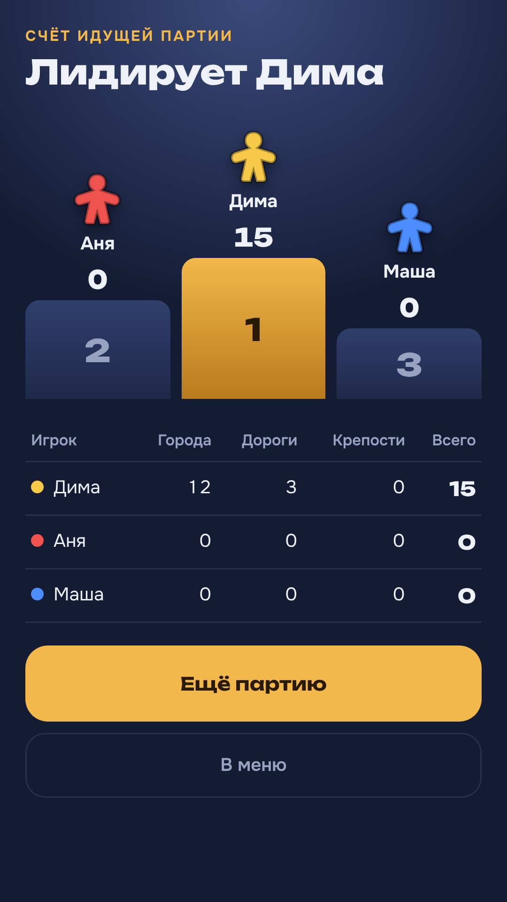

<h1 align="center">Puzzlegrad</h1>

<b>Стройте города, дороги и крепости из общей стопки карт-пазлов.</b> 
Короткие партии на 8–30 минут: с ботами, на одном телефоне, онлайн на кубки и в комнатах с друзьями.

  <a href="https://crownfall90-dot.github.io/play/"><b>▶ Играть в браузере</b></a> ·
  <a href="https://github.com/crownfall90-dot/play/releases/latest/download/Puzzlegrad.apk"><b>⬇ Скачать для Android</b></a> ·
  <a href="docs/privacy-policy.md">Политика конфиденциальности</a>

  

## Об игре
- **Партия за 8–30 минут.** «Быстрая» — 30 карт, «Классика» — 50, «Большая» — 100.
- **Онлайн на кубки**: быстрый поиск соперников, рейтинг, карта соперника видна ещё до его хода.
- **С друзьями**: комната по коду или приглашение в один тап.
- **С ботами трёх уровней** и **на одном телефоне** — без интернета.
- **Подсказки-тренер**: сколько очков даст город или дорога и что осталось достроить.
- **Профиль на всех устройствах**: телефон, приложение и браузер — один прогресс.

## Установка
- **Android:** скачайте [Puzzlegrad.apk](https://github.com/crownfall90-dot/play/releases/latest/download/Puzzlegrad.apk) и откройте файл. Приложение обновляется само.
- **iPhone и компьютер:** откройте [веб-версию](https://crownfall90-dot.github.io/play/) и добавьте на главный экран.

## Поддержка
Нашли ошибку или есть идея — «Настройки → Написать разработчику» в игре. Уязвимости безопасности — по правилам в [SECURITY.md](SECURITY.md).

## Права
© 2026 Crownfall. Все права защищены. Код, графика, звуки и тексты игры — собственность автора; копирование, распространение и использование в своих проектах без письменного разрешения запрещены. Подробно — [LICENSE](LICENSE).

---

Для разработчиков проекта

Это рабочий репозиторий команды Puzzlegrad. Начните с [docs/product/README.md](docs/product/README.md) (видение, режимы, удержание, очередь задач, аудит), затем [docs/coordination/HANDOFF.md](docs/coordination/HANDOFF.md).

- `web/game.html` + `src/` — игра (модули собираются Vite в `build/bundle/pg.js`), `app/` — Android-оболочка, `scripts/` — сборка и обслуживание, `tests/` — тесты (`npm run build && node --test tests/*.test.cjs`).
- Выпуск — только по команде владельца через «Promote to Production»; заметки для игроков — `release-notes.md`.
- Подпись приложения — [docs/SIGNING-KEY-ROTATION.md](docs/SIGNING-KEY-ROTATION.md); безопасность репозитория — [docs/REPO-SECURITY.md](docs/REPO-SECURITY.md).

