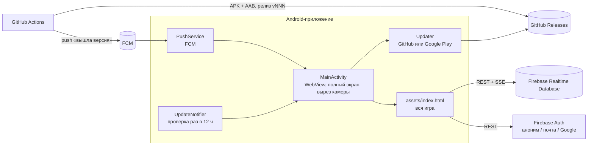

# Puzzlegrad — карта проекта

Короткая карта: что где лежит, как части связаны и куда смотреть, когда что-то меняешь.

## Как устроено в целом

* **Вся игра — один файл** `web/game.html` (HTML + CSS + JS, без сборщиков). Скрипт `scripts/wrap-web.sh` заворачивает его в `app/src/main/assets/index.html` (шрифты, заметки к версии, конфиг Firebase).
* **Android-часть тонкая**: WebView, обновления, пуши, отчёты о сбоях (Crashlytics). Логика игры в Java не дублируется.
* **Сервера своего нет**: онлайн, рейтинг, присутствие и профили — Firebase Realtime Database через REST, вход — Firebase Auth через REST (аноним, почта с паролем, Google).
* **Вход через Google**: WebView не запускает Google-вход сам, поэтому токен даёт нативная шторка на телефоне (`AndroidApp.googleSignIn` → Credential Manager → `window.onGoogleToken`), дальше игра меняет его на сессию Firebase (`accounts:signInWithIdp`). В веб-сборке кнопку рисует Google Identity Services. Нужен web OAuth-клиент (`client_type` 3) в `google-services.json`. Настройка: Firebase → Authentication → Sign-in method → Google вкл.; в Firebase → Project settings → Your apps добавить SHA-1 ключа подписи (отпечаток `app/release.keystore` и ключа подписи Google Play) — тогда Firebase создаёт Android-клиент; перекачать `google-services.json` (в нём появится web-клиент) и выпустить сборку. GitHub-сборка: `keytool -list -v -keystore app/release.keystore -alias mosaic` (пароль по умолчанию в `app/build.gradle`).

## Файлы

| Путь | Что внутри |
|---|---|
| `web/game.html` | Игра целиком: экраны, графика, правила, боты, онлайн, прогресс, обучение |
| `scripts/wrap-web.sh` | Сборка `assets/index.html` из `web/game.html` (запускать после каждой правки); `wrap-web.sh web N` — сайт в `build/web/` |
| `web/manifest.webmanifest`, `web/sw.js`, `web/icons/` | Веб-версия: установка на экран «Домой», офлайн-кэш, иконки |
| `.github/workflows/pages.yml` | Публикация веб-версии на GitHub Pages при каждом push в `main` |
| `app/src/main/java/.../MainActivity.java` | WebView, полный экран, вырез камеры → CSS-переменные `--it/--ib/--il/--ir/--itg`, мост `AndroidApp` |
| `app/src/github/.../Updater.java`, `InstallResult.java` | Самообновление из GitHub Releases через PackageInstaller |
| `app/src/play/.../Updater.java` | Обновление через Google Play (In-App Updates) |
| `app/src/main/java/.../PushService.java` | FCM: тема `updates-github` / `updates-play` |
| `app/src/main/java/.../UpdateNotifier.java` | Уведомление «вышло обновление»: одно на версию; если телефон уже получил уведомление о версии, до которой ещё не обновился, следующие молчат (пуш уходит на тему, решает сам телефон) |
| `app/src/main/java/.../UpdateNotifier.java` | Фоновая проверка версии и уведомление |
| `.github/workflows/android.yml` | Сборка APK/AAB, релиз `vNNN` (`versionCode = 100 + номер запуска`), пуш игрокам |
| `.github/workflows/notify.yml` | Ручная отправка пуша о версии |
| `.github/workflows/news.yml` | Пуш-новость всем игрокам (тема `news`; проверка — `news-test`). Запускается из скрытой «Панели владельца»: 7 нажатий на «Версия» в настройках, токен GitHub хранится только на телефоне владельца |
| `scripts/fcm-send.py` | Отправка пуша FCM (секрет `FIREBASE_SERVICE_ACCOUNT`) |
| `docs/firebase-rules.json` | Правила базы — публикуются вручную в консоли Firebase |
| `release-notes.md` | «Что нового» — показывается в игре после обновления |
| `docs/google-play.md`, `docs/privacy-policy.md`, `store/` | Всё для публикации в Google Play |

## Разделы `web/game.html`

Файл поделён комментариями `/* ---------------- раздел ---------------- */`. Искать по ним.

| Раздел | Главное |
|---|---|
| **art** | `TYPES` (все карты: края `c` город, `r` дорога, `f` поле, `w` река, `b` большой мост), редкие карты (генерируются), `drawTile` (рисунок карты на canvas), `drawSprites` (домики, деревья, крепость, шахта…) |
| **rules** | `fits` (подходит ли карта), `groupsOf` / `component` (объекты), `claimable` (куда можно фишку) |
| **dom: world** | `tileEl` (объёмная плитка), `walls` (стенки и водопады), `addDecor` (объекты на карте) |
| **camera & input** | `cam`, `applyCam`, жесты: палец — сдвиг, два пальца — масштаб/поворот/наклон; класс `flat` в 2D |
| **hud** | Карточки игроков, лоток с картой, подсветка владельца (`updateOwnership`), флажки (`markDone`) |
| **turns** | `startTurn`, `afterPlace`, `scoreAfter`, `resolveFeature` (очки, `roadPoints` — мост), таймер, 10 с на фишку, бот (`botPick`, `aiTurn`), `endGame`, золото (`payout`) |
| **setup** | Экран настроек, режимы `MODES` (Быстрая/Классика/Большая), `deckList` / `makeDeck`, правила `RULES` |
| **gold, figures, shop** | Кошелёк `wallet` (localStorage), фигурки, подарок дня, покупка с подтверждением |
| **saved game** | Офлайн-партия сохраняется как «настройки + список ходов» и восстанавливается повтором |
| **sound** | Звуки и музыка синтезируются Web Audio (`SFX`, `musicStart`) |
| **settings / game menu** | Настройки, пауза, сдаться, ничья |
| **online** | Комната = журнал сообщений в `/rooms/{код}/msgs`. Сообщения: `host`, `hello`, `lobby`, `start`, `move`, `here`, `say`, `resign`, `draw`. Все телефоны повторяют одни и те же ходы → одинаковая партия. Сторож (`startWatch`) ходит ботом за пропавшего |
| **quick match** | Поиск: объявления `seek`/`close` в комнате `QMATCH`, совпадение по режиму и числу игроков, рейтинговые правила `ratedRules` |
| **progress** | Уровень/опыт, задания дня, достижения, рейтинг `/leaders` (кубки только за рейтинговые партии) |
| **tutorial** | Партия по сценарию: `TUT`, `TUT_DECK`, `TUT_BOT`, шаги ждут действия (`tutEvent`) |
| **friends** | Только для сохранённых профилей (`registered()`: никнейм + вход по почте; правила требуют почту в токене и запись в `/profiles` у обоих). Код друга `/fcodes`, заявки и приглашения в комнату через `/inbox/{uid}` (живой поток + опрос раз в минуту), список `/friends/{uid}`, в сети / не в сети по `/presence` |
| **account** | Профиль: никнейм, смена имени (500 золота), вход по почте или через Google, облачное сохранение `/profiles/{uid}` |
| **screens / app shell** | `show(name)`, кнопка «Назад» Android, обновления, заставка. `isAndroid` / `isWeb` / `isApp` |
| **invite links** | `https://…/play/?friend=КОД` и `?room=КОД` (и `puzzlegrad://friend/КОД`): приложение открывается по ссылке (intent-filter в манифесте, `onNewIntent` → `window.onDeepLink`), в браузере Android сначала предлагается «Открыть в приложении». Карточка «X приглашает вас в друзья» (`friendInvite`); принятая заявка несёт `v` = код приглашения, и игра пригласившего принимает её сама. Для автоматического открытия без вопроса нужен свой домен + `assetlinks.json` |
| **web build** | `SITE_URL`, установка (`installDialog`, `beforeinstallprompt`), «назад» браузера через history, ссылки `?room=` и `?friend=`, service worker |

## Данные

| Где | Что |
|---|---|
| `localStorage.wallet` | Золото, фигурки, настройки, имя профиля, прогресс (`prog`), флаги обучения |
| `localStorage.setup` | Последние настройки партии и места игроков |
| `localStorage.savedGame` | Офлайн-партия для «Продолжить» |
| `localStorage.lastGame` | Онлайн-партия для возврата после перезапуска (3 часа) |
| `localStorage.fbAuth` | Токены Firebase (+ почта, если профиль защищён) |
| `/rooms/{код}/msgs` | Журнал онлайн-комнаты (только добавление) |
| `/presence/{uid}` | «В сети»: время, имя, занятие (`off` — вышел, время = когда был в сети) |
| `/friends/{uid}/{друг}` | Мой список друзей; дружба взаимна, когда оба списка содержат друг друга |
| `/inbox/{uid}/{от}_f` / `_r` | Заявка в друзья / приглашение в комнату (15 минут) |
| `/fcodes/{КОД}` | Код друга → uid (6 символов, пишется один раз) |
| `/guestN` | Счётчик номеров игроков (последний выданный) |
| `/playerNo/{uid}` | Скрытый номер игрока. Без никнейма игрок зовётся `nickname<номер>`. Старым игрокам номера были выданы один раз по дате регистрации (разовая задача, уже выполнена и удалена из репозитория) |
| `/fcodeOf/{uid}` | uid → его код друга (постоянный: возвращается после переустановки) |
| `/leaders/{uid}` | Рейтинг: имя, кубки (не больше +30 в минуту) |
| `/profiles/{uid}` | Облачная копия кошелька. Синхронизируется между устройствами (приложение, веб, другой телефон): слияние с базовой копией `localStorage.walletBase`, запись по ETag |

## Частые задачи

* **Новая карта** → добавить в `TYPES` (края по часовой: N, E, S, W; `n` — сколько в колоде). Рисунок построится сам; особый вид — ветка в `drawTile` по `id`, объекты — в `addDecor`.
* **Новый режим** → запись в `MODES` (`set` — какие правила он выставляет), при необходимости правка `deckList`.
* **Новое сообщение онлайн** → отправить `netSend({t: '…', g: net.gameId, …})`, обработать в `onNet`. Всё, что меняет партию, должно приходить одинаково на все телефоны.
* **Новые данные в базе** → правило в `docs/firebase-rules.json` и опубликовать его в консоли Firebase.
* **Новое в игре** → PR в main. Сама по себе выпускная сборка не запускается: в `release-notes.md` добавляется строка для игрока (только то, что видит игрок; служебное не упоминать).
* **Экран телефона** → `MainActivity.screenInches()`: диагональ в дюймах по размеру панели; для известных моделей точное значение из `KNOWN_INCHES` (ключ «производитель модель» в нижнем регистре). Модель и диагональ уходят в запись присутствия (`m`, `i`) для статистики владельца. Эталон интерфейса — realme GT3 240W (6,74″, масштаб 1): остальные телефоны масштабируются относительно него (`REFERENCE_INCHES`, предел 0,85–1,2). Чтобы уточнить модель, добавьте её в `KNOWN_INCHES` и выпустите версию.
* **Выпустить обновление** → только по команде владельца «собираем следующее обновление»: запускается `Android APK` и `Web version` через workflow_dispatch с накопленным `release-notes.md`. После успешной сборки файл очищается отдельным коммитом. Пустой `release-notes.md` сборку останавливает.
  После успешной сборки выпуска (и отката) журнал обновляю сам: `python3 scripts/changelog.py` → `docs/CHANGELOG.md`, через PR.
* **Откат к прежней версии** → Actions → «Android APK» (и «Web version») → Run workflow → поле `rollback` = тег, например `v170`. Сборка берёт код этой версии и выпускает его как новую версию с большим номером, поэтому установленные приложения обновятся до неё. Игрокам уходит текст «Возврат к версии 1.0.170». Старые релизы остаются на странице Releases. Откат меняет только код игры: профили и данные сервера не откатываются, поэтому старой версии нужна совместимость с текущими данными (в истории релизов это проверено только для недавних версий).

## Проверка перед выпуском

Тесты — сценарии Playwright (Chromium), запускаются на `app/src/main/assets/index.html`: полная партия с ботами, онлайн-комната на настоящем Firebase, быстрый поиск, обучение, бездействие, замер кадров при прокрутке поля (замедление CPU ×4). Тестовым клиентам отключать `/presence`, чтобы они не попадали в счётчик «в сети».
